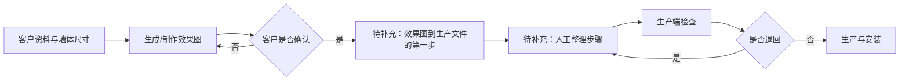

# 当前人工流程图

- 案例编号：{{CASE_ID}}
- 案例名称：{{CASE_NAME}}

先根据访谈和录屏填写 `人工流程记录.csv`，再把真实步骤更新到下面的流程图。节点名称使用设计人员实际动作，括号中标注工具和平均耗时。

## 各阶段耗时汇总

| 阶段 | 人工耗时 | 等待耗时 | 返工次数 | 证据 |
|---|---:|---:|---:|---|
| 效果图确认前 |  |  |  |  |
| 效果图到生产文件 |  |  |  |  |
| 生产端检查与返工 |  |  |  |  |

## 关键交接点

| 上游角色 | 下游角色 | 交付内容 | 实际文件 | 缺失信息 | 常见问题 |
|---|---|---|---|---|---|
|  |  |  |  |  |  |

